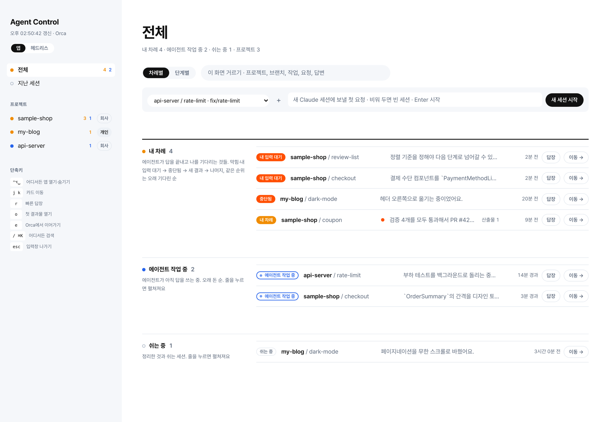
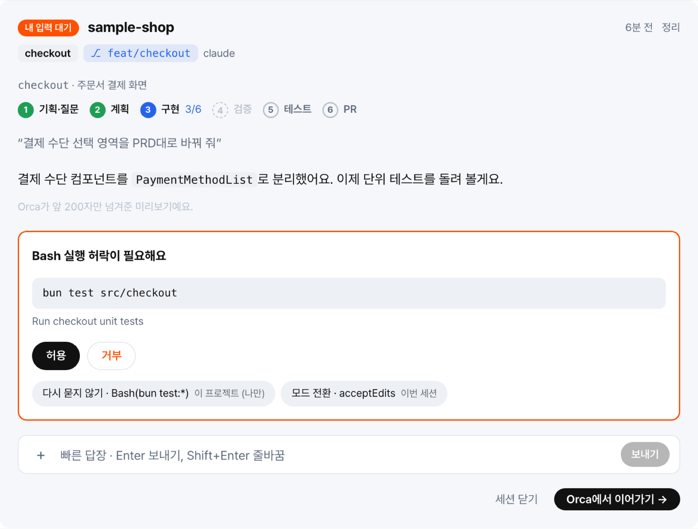
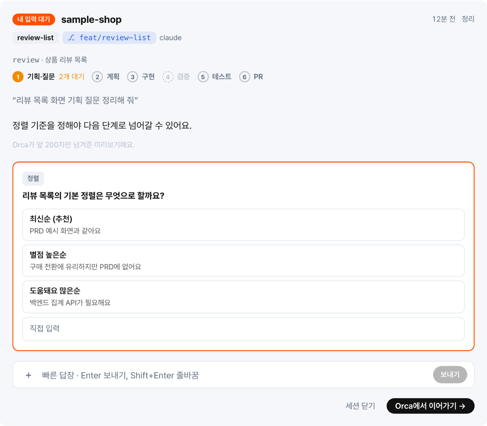
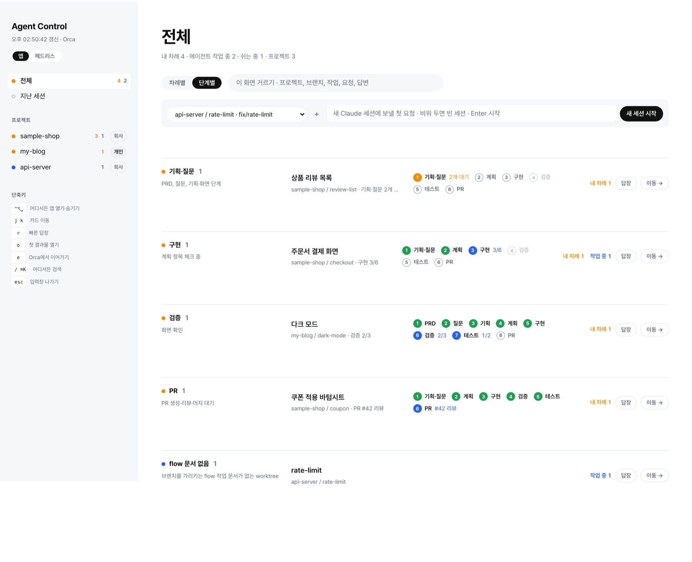
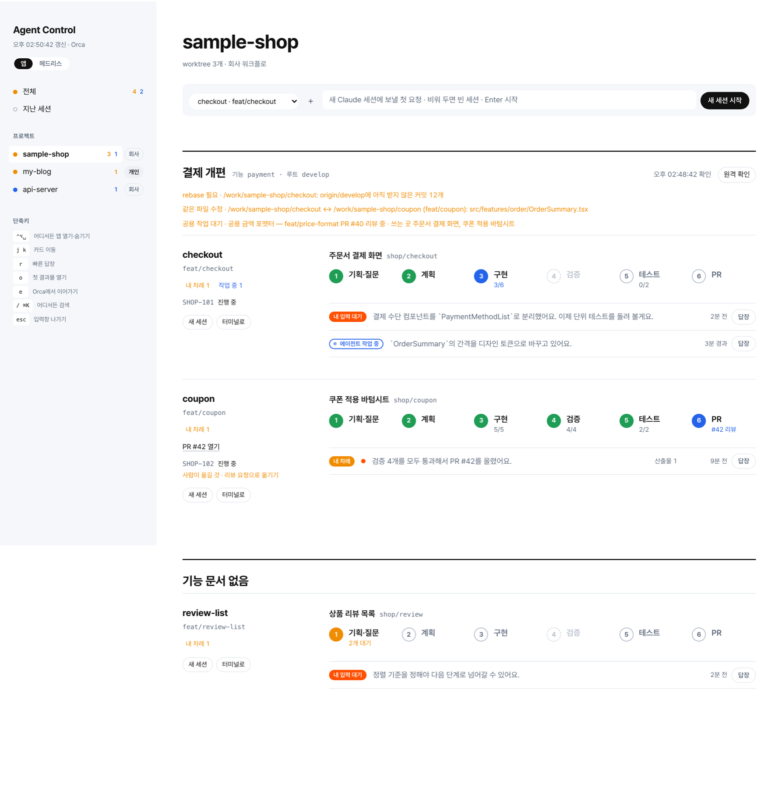
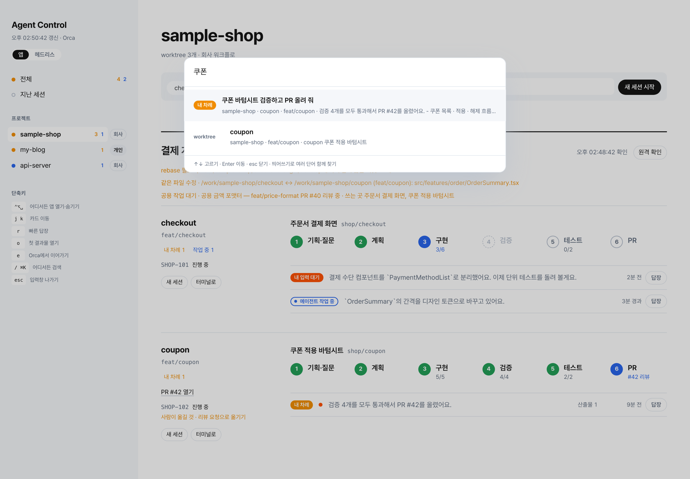
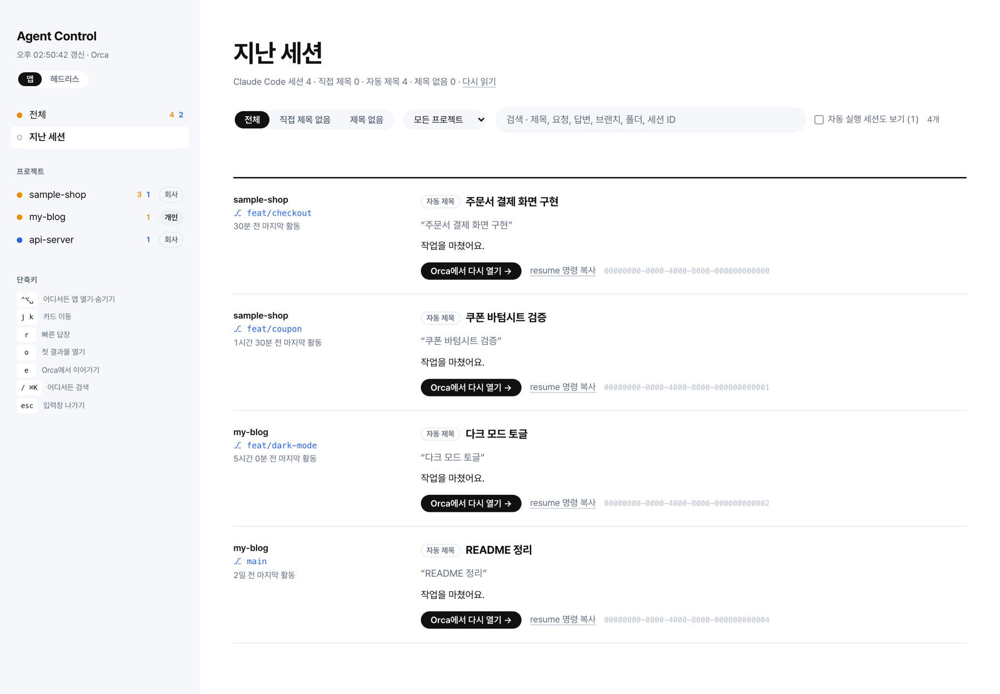

# Agent Control

여러 worktree에서 동시에 돌아가는 Claude Code 에이전트를 한 화면에서 지켜보고, 내 차례가 된 것만 골라 바로 답하는 macOS용 관제 대시보드입니다.



> 스크린샷은 모두 샘플 데이터로 찍었습니다.

## 왜 만들었나

에이전트를 worktree마다 하나씩 띄워 두면, 어느 터미널이 허락을 기다리는지, 어느 쪽이 끝났는지 알려면 탭을 하나씩 열어 봐야 합니다. Agent Control은 [Orca](https://github.com/stablyai/orca)가 관리하는 터미널과 에이전트 상태를 모아서 **지금 내가 봐야 하는 것**부터 위에 올려 줍니다. 권한 허락, 질문 답변, 짧은 후속 지시까지 터미널로 가지 않고 이 화면에서 끝낼 수 있습니다.

## 주요 기능

- **차례별 보기** — 에이전트를 `내 차례` / `에이전트 작업 중` / `쉬는 중`으로 나누고, 막힘·입력 대기 → 중단됨 → 새 결과 순으로 정렬
- **권한 요청 · 질문 카드** — Claude Code의 권한 요청과 `AskUserQuestion` 질문을 카드에서 바로 허용·거부·선택
- **빠른 답장** — 카드 아래 입력창으로 해당 터미널에 바로 프롬프트 전송, 이미지 첨부 가능
- **단계별 보기** — flow 작업 문서를 읽어 기획·질문 → 계획 → 구현 → 검증 → 테스트 → PR 중 어디에 있는지 표시
- **기능별 worktree 묶음** — 같은 기능을 나눠 맡은 worktree를 묶고, rebase 필요 · 같은 파일 수정 · 공용 작업 대기 경고 표시
- **지난 세션** — 끝난 Claude Code 세션을 찾아 Orca에서 다시 열기
- **데스크톱 앱** — Dock에 고정되는 Electron 앱, `⌃⌥Space`로 어디서든 열기·숨기기

## 사용 방법

### 1. 전체 화면에서 내 차례 확인하기

왼쪽 사이드바의 **전체**를 누르면 모든 프로젝트의 에이전트가 세 구역으로 나뉘어 보입니다.

| 구역 | 들어가는 에이전트 |
|---|---|
| 내 차례 | 답을 끝냈거나, 권한·질문에 막혔거나, 중간에 멈춘 에이전트 |
| 에이전트 작업 중 | 아직 답을 쓰고 있는 에이전트 (오래 돈 순) |
| 쉬는 중 | 할 일 없이 쉬는 세션, 또는 **정리**로 치워 둔 에이전트 |

줄을 누르면 카드가 펼쳐집니다. **답장**은 카드를 펼치지 않고 바로 입력창만 엽니다. **이동 →**은 그 에이전트가 속한 프로젝트 화면으로 넘어갑니다. 위쪽 검색창에 프로젝트·브랜치·요청 내용을 입력하면 이 화면만 걸러집니다.

### 2. 권한 요청과 질문에 답하기

에이전트가 명령 실행 허락을 구하면 카드에 주황색 테두리 패널이 뜹니다.



- **허용** / **거부** — 이번 한 번만 결정
- **다시 묻지 않기** — 같은 종류의 명령을 이 프로젝트에서 계속 허용 (Claude Code가 제안한 규칙 그대로)
- **모드 전환** — 이번 세션을 `acceptEdits` 같은 모드로 바꿈

에이전트가 선택지를 내밀며 물어볼 때도 같은 자리에 질문 카드가 뜹니다. 보기를 누르거나 **직접 입력**에 답을 쓰면 터미널로 전달됩니다.



> 권한 · 질문 카드는 아래 [권한 요청 훅 연결](#권한-요청-훅-연결)을 해야 나타납니다.

### 3. 단계별로 진척 보기

전체 화면 위쪽의 **단계별**을 누르면 worktree를 지금 있는 작업 단계로 묶어 보여 줍니다. 한 줄에서 작업 제목, 단계 진행 표시, 내 차례 · 작업 중 수를 함께 볼 수 있습니다.



단계 정보는 각 worktree의 `docs/<도메인>/tasks/*.json`(flow 작업 문서)에서 읽습니다. 문서가 없는 worktree는 맨 아래 **flow 문서 없음**에 모입니다.

### 4. 프로젝트 화면에서 기능 단위로 보기

사이드바에서 프로젝트를 고르면 worktree별 패널이 나옵니다. 같은 기능 문서를 공유하는 worktree는 기능 이름 아래에 묶입니다.



- **원격 확인** — 기준 브랜치를 fetch해서 경고를 다시 계산합니다
  - `rebase 필요`: 기준 브랜치에 아직 받지 않은 커밋이 있는 worktree
  - `같은 파일 수정`: 두 worktree가 같은 파일을 고치고 있음
  - `공용 작업 대기`: 여러 작업이 기다리는 공용 코드의 PR이 아직 머지되지 않음
- **새 세션** — 이 worktree에서 Claude 세션을 새로 시작
- **터미널로** — Orca에서 이 worktree의 터미널로 이동

프로젝트 이름 옆의 **회사 / 개인** 배지는 진척 단계 구성을 바꿉니다. 저장소 owner가 내 GitHub 계정이면 개인(PRD → 질문 → 기획 …), 아니면 회사(기획·질문 → 계획 …)로 자동 판단하고, 배지를 눌러 바꿀 수 있습니다.

### 5. 어디서든 검색하기

`⌘K` 또는 `/`를 누르면 에이전트, worktree, 작업을 한 번에 찾는 검색창이 열립니다. 띄어쓰기로 여러 단어를 함께 찾을 수 있고, `Enter`로 바로 이동합니다.



### 6. 지난 세션 다시 열기

사이드바의 **지난 세션**은 `~/.claude/projects` 아래 Claude Code 세션 기록을 모아 보여 줍니다. **Orca에서 다시 열기**를 누르면 그 폴더에서 세션을 이어서 시작하고, **resume 명령 복사**로 직접 터미널에서 이어갈 수도 있습니다.



### 단축키

| 키 | 동작 |
|---|---|
| `⌃⌥Space` | 어디서든 앱 열기 · 숨기기 (데스크톱 앱) |
| `j` / `k` | 카드 이동 |
| `r` | 빠른 답장 |
| `o` | 첫 결과물 열기 |
| `e` | Orca에서 이어가기 |
| `/` · `⌘K` | 검색 |
| `esc` | 입력창 나가기 |

## 시작하기

### 준비물

- macOS
- [Orca](https://github.com/stablyai/orca) — 터미널과 에이전트 상태를 이 앱에서 읽어 옵니다. 기본 경로는 `/Applications/Orca.app`이고, 다르면 `ORCA_BIN` 환경 변수로 CLI 경로를 지정합니다.
- [Claude Code](https://claude.com/claude-code)
- [Bun](https://bun.sh)
- [GitHub CLI](https://cli.github.com) (`gh`) — 로그인돼 있으면 PR 상태와 회사/개인 판단에 씁니다. 없어도 나머지 기능은 동작합니다.

### 개발 서버로 실행

```bash
bun install
bun run dev
```

http://127.0.0.1:3100 에서 열립니다.

### 데스크톱 앱으로 설치

```bash
bun run desktop
```

`~/Applications/Agent Control.app`을 만들고 Dock에 고정합니다. 앱은 내부 서버를 `127.0.0.1:3199`에서 띄웁니다. 코드를 고친 뒤에는 이 명령을 다시 실행해야 앱에 반영됩니다.

### 권한 요청 훅 연결

권한 · 질문 카드를 쓰려면 Claude Code가 권한 요청을 이 앱으로 보내도록 `~/.claude/settings.json`에 훅을 등록합니다. 기존 설정은 그대로 두고 이 앱의 항목만 추가합니다.

```bash
bun run hook:install                 # 데스크톱 앱(3199)으로 연결
bun run hook:install -- --port 3100  # 개발 서버로 연결
bun run hook:uninstall               # 제거
```

훅이 앱에 닿지 않으면 Claude Code는 원래대로 터미널에서 허락을 묻습니다.

### Orca 실행 방식 전환

사이드바 위쪽의 **앱 / 헤드리스** 스위치로 Orca를 창이 있는 앱으로 띄울지, 창 없이 백그라운드로만 띄울지 바꿀 수 있습니다.

## 기술 스택

Next.js 16 · React 19 · Tailwind CSS 4 · TypeScript · Electron

## 구조

```
src/
  app/api/          # board · actions · sessions · hooks/permission 등 로컬 API
  features/board/   # 대시보드 화면 컴포넌트
  lib/orca/         # Orca CLI 호출과 보드 데이터 조립
  lib/workflow/     # flow 작업 문서 · 기능 문서 · git/PR 상태 읽기
  lib/permissions/  # 권한 요청 대기열
  lib/sessions/     # Claude Code 세션 기록 읽기
desktop/            # Electron 진입점
scripts/            # 데스크톱 빌드 · 설치, 권한 훅 설치
```
