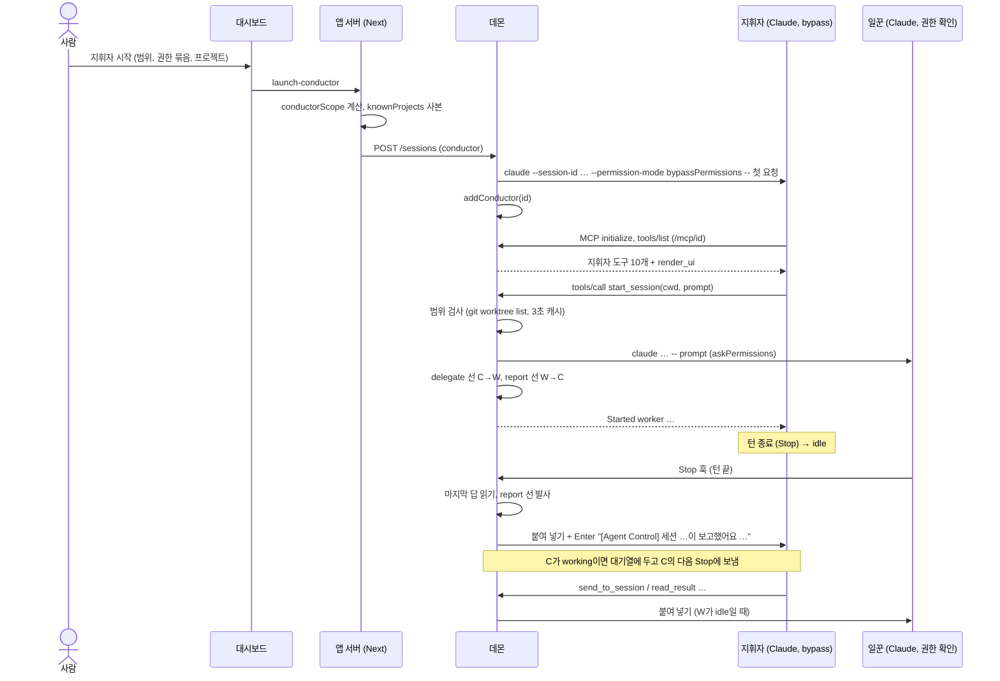
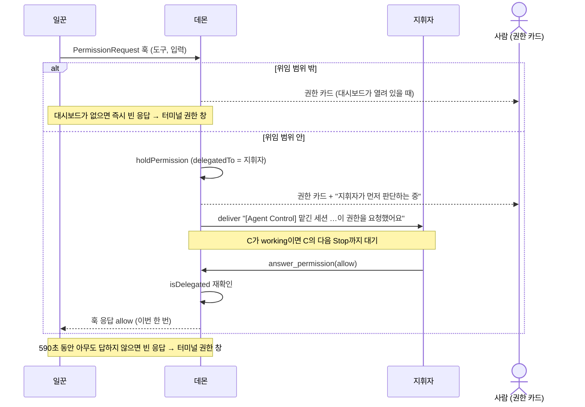

# 지휘자 세션 — 지금 코드가 하는 일

2026-11-25 `main` 작업 트리 기준. 코드를 고치지 않고, 지금 무엇을 하는지만 적었다. 각 주장 끝의 `파일:줄`이 근거다.

## 개요

지휘자(conductor)는 "일을 나눠 다른 Claude 세션(일꾼)에게 맡기고 보고를 받는" Claude Code 세션이다. 실제로는 평범한 Claude Code 터미널에 세 가지가 더 붙은 것이다.

- 데몬이 띄우는 MCP 서버에 지휘자 전용 도구 10개가 생긴다 (`daemon/orchestration/conductorMcp.ts:26-122`).
- 시스템 프롬프트에 "직접 다 하지 말고 일꾼에게 맡겨라"는 안내가 붙는다 (`daemon/orchestration/conductorMcp.ts:124-134`). 안내일 뿐 강제는 아니다.
- 일꾼이 한 턴을 끝낼 때마다 데몬이 그 마지막 답을 지휘자 터미널에 **사람이 친 것처럼 붙여 넣고 Enter를 누른다** (`daemon/main.ts:138-141`).

불안정 지점 중 가장 큰 세 가지:

1. **데몬이 재시작되면 진행 중이던 일이 조용히 끊긴다.** 일하던 일꾼은 죽고 빈 상태로 다시 열려 보고를 보내지 않는다. 지휘자에게 갈 보고 대기열, 워크트리·프로젝트 요청도 메모리에만 있어서 사라진다. 지휘자는 "보고가 오면 알려 줄게"라고 한 채 영원히 기다린다.
2. **메시지 대기열은 "그 세션이 턴을 끝낼 때"에만 다시 흘러간다.** Esc로 끊은 턴, 메뉴가 열려 있던 경우, 붙여 넣은 텍스트가 제출되지 않은 경우에는 Stop 이벤트가 오지 않아 다음 메시지가 무기한 묶인다.
3. **지휘자 자신은 권한 확인 없이(`bypassPermissions`) 돈다.** 범위(scope)는 지휘자가 MCP 도구로 일꾼을 열 수 있는 폴더만 제한한다. 지휘자는 자기 터미널에서 아무 파일이나 고치고 `git push`도 할 수 있다. 일꾼에게 맡긴 권한 묶음도 경로를 보지 않는다.

## 구성 요소

| 위치 | 이름 | 하는 일 |
|---|---|---|
| 데몬 | `daemon/server.ts` | HTTP 라우트: 세션 실행(`POST /sessions`), MCP(`/mcp/:id`), 훅(`/hooks/:id/:event`), 권한, 워크트리·프로젝트 요청 정산 |
| 데몬 | `daemon/orchestration/Orchestration.ts` | 지휘자 목록, 세션 사이 선(link), 세션별 메시지 대기열, 마지막 답 |
| 데몬 | `daemon/orchestration/conductorMcp.ts` | 지휘자 MCP 도구 정의와 실행 |
| 데몬 | `daemon/orchestration/grants.ts` | 권한 묶음(`edit`/`build`/`commit`)과 위임 규칙 판정 |
| 데몬 | `daemon/session/SessionRegistry.ts` | pty로 Claude 프로세스를 띄우고 상태·권한 보류를 관리 |
| 앱 서버 | `src/server/orchestration/conductorActions.ts` | 지휘자 실행, 워크트리·프로젝트 요청 승인 처리 |
| 앱 서버 | `src/server/orchestration/conductorScope.ts` | 보드 정보로 지휘자 범위 계산 |
| 공용 타입 | `src/common/orchestration/types.ts` | 공용 타입 `Conductor`, `ConductorScope`, `OrchestrationLink`, `ConductorLaunch` |

## 1. 여는 경로와 범위 종류

### 진입점

어디서 열든 같은 폼(클라이언트 컴포넌트 `ConductorLauncher`)이 뜨고, 앱 서버 액션 `launch-conductor`로 간다.

| 화면 | 근거 | 범위 종류 | 넘기는 `worktreePath` |
|---|---|---|---|
| 프로젝트 캔버스 도구 막대 "지휘자" | `src/client/widgets/project-graph/ui/GraphToolbar.tsx:94-97` | `project` (프로젝트 화면) `app` (프로젝트가 없는 화면) | 그 프로젝트의 메인 워크트리 `null` |
| 캔버스 워크트리 우클릭 메뉴 "지휘자" | `src/client/widgets/project-graph/ui/canvasMenuItems.ts:309` → `CanvasOverlays.tsx:157` | `worktree` | 그 워크트리 |
| 워크트리 패널 "지휘자" | `src/client/widgets/worktree-panel/ui/WorktreePanel.tsx:165-169`, `482-488` | `worktree` | 그 워크트리 |
| 사이드바 '전체' 화면 | `src/client/views/dashboard/ui/AllLaunch.tsx:32-33` | `app` | `null` |

폼 기본값 (`src/client/features/conduct-sessions/ui/ConductorLauncher.tsx`):

- 권한 묶음: `edit`(파일 편집), `build`(테스트·빌드 명령)가 켜진 채 시작 (`:30`). `commit`은 꺼져 있다.
- 함께 맡길 프로젝트: `app`은 보드의 모든 프로젝트가 골라진 채, 나머지는 아무것도 안 골라진 채 시작 (`:39`). `app`에서 하나도 안 고르면 시작 버튼이 꺼진다 (`:40`).
- 첫 요청(prompt)은 비워도 된다 (`src/server/orchestration/conductorActions.ts:36-40`).

### 실행 경로

1. 앱 서버 함수 `launchConductor`가 보드의 워크트리 목록으로 범위를 계산한다 (`conductorActions.ts:31-43`). 이때 보드에 있는 프로젝트 목록을 `knownProjects`로 함께 보낸다 (`:41`). 실행 시점의 사본이라 나중에 보드에 추가된 프로젝트는 안 들어간다.
2. 데몬 `POST /sessions`가 요청을 읽는다 (`daemon/server.ts:338-354`). 함수 `conductorLaunchOf`가 범위를 다시 검사하고, `worktree` 범위면 자기 폴더를 `paths`에 넣는다 (`:105-120`).
3. `app` 범위면 앱이 보낸 `cwd: "/"`(`src/server/orchestration/conductorScope.ts:7`)를 데몬 데이터 폴더 아래 `conductor` 폴더로 바꾸고 만든다 (`daemon/server.ts:340-345`).
4. `registry.launch`로 Claude 프로세스를 띄운 뒤 바로 `orchestration.addConductor`로 지휘자 표시를 붙인다 (`daemon/server.ts:350-351`).
5. 실행 명령(`daemon/session/command.ts:50-69`): MCP 서버 주소 `/mcp/<세션 id>`, 지휘자 안내문, `--allowedTools mcp__agent-control`, 그리고 `--permission-mode bypassPermissions`. 데몬 함수 `launchRequestOf`는 요청 본문의 `askPermissions`를 읽지 않으므로(`daemon/server.ts:122-136`) 사람이 연 지휘자는 언제나 권한 확인 없이 돈다 (`command.ts:64`).

### 범위 종류별 차이

범위는 공용 타입 `ConductorScope`(`root` 실행 폴더 / `paths` 하나씩 허락된 워크트리 폴더 / `projects` 모든 워크트리가 범위인 프로젝트 폴더)로 저장된다 (`src/common/orchestration/types.ts:33-41`).

| 종류 | 실행 폴더 (`root`) | `paths` | `projects` | 근거 |
|---|---|---|---|---|
| `worktree` | 그 워크트리 | 그 워크트리 + **실행 시점에** 그 워크트리에서 갈라져 나온 하위 워크트리 | 함께 맡긴 다른 프로젝트 (자기 프로젝트는 빠짐) | `conductorScope.ts:34-43` |
| `project` | 프로젝트 폴더(메인 워크트리) | 비어 있음 | 자기 프로젝트 + 함께 맡긴 프로젝트 | `conductorScope.ts:31-33` |
| `app` | 데몬 데이터 폴더의 `conductor` (빈 폴더) | 비어 있음 | 고른 프로젝트들 | `conductorScope.ts:28`, `daemon/server.ts:340-345` |

- `projects`에 있는 프로젝트는 도구를 부를 때마다 `git worktree list`로 지금의 워크트리 목록을 읽는다. 3초 캐시가 있다 (`daemon/orchestration/projectWorktrees.ts:15-34`). git이 실패하면 프로젝트 폴더 하나만 범위가 된다 (`:28-29`).
- `paths`는 고정 목록이다. `worktree` 지휘자를 연 **뒤에** 사람이 그 아래에 만든 하위 워크트리는 범위에 들어가지 않는다. 지휘자가 `request_worktree`로 만든 것만 추가된다 (`Orchestration.ts:313`).
- 폴더 판정은 문자열 접두사 비교다 (`Orchestration.ts:109-111`).

## 2. 지휘자 도구와 일꾼 흐름

### MCP 연결

모든 Claude 세션은 같은 주소 형식 `/mcp/<세션 id>`로 데몬 MCP 서버에 붙는다 (`daemon/session/command.ts:24-43`). 데몬은 요청이 올 때마다 그 id가 지휘자인지 보고 도구 목록을 고른다 (`daemon/server.ts:310-326`). 지휘자면 아래 10개 + `render_ui`, 아니면 `render_ui`만 보인다.

### 도구 목록

모든 도구는 실행 전에 범위 폴더 목록을 다시 계산한다 (`conductorMcp.ts:161-166`). "범위 안 세션"은 **cwd가 범위 폴더 안에 있는 모든 세션**이다. 그 지휘자가 연 일꾼인지는 보지 않는다.

| 도구 | 실제로 하는 일 | 근거 |
|---|---|---|
| `list_projects` | 범위 프로젝트와 각 워크트리, `paths`, 아직 안 맡은 `knownProjects`를 JSON으로 돌려준다 | `conductorMcp.ts:169-173` |
| `list_worktrees` | 범위 폴더마다 살아 있는 세션 수 | `:174-178` |
| `list_sessions` | 범위 안 세션의 id·폴더·상태·맡긴 지휘자·대기 중 권한 요청 | `:179-182` |
| `start_session` | 범위 안 절대 경로인지, 폴더가 있는지 확인 → 일꾼을 `askPermissions: true`로 실행(첫 요청은 CLI 인자로) → 지휘자→일꾼 `delegate` 선, 일꾼→지휘자 `report` 선을 긋는다 | `:183-195` |
| `send_to_session` | 범위 안 세션에 텍스트를 대기열로 보낸다. 쉬고 있으면 바로 붙여 넣고, 바쁘면 그 세션의 다음 Stop까지 기다린다 | `:196-204` |
| `read_result` | 상태 + 데몬 메모리의 마지막 답 | `:205-209` |
| `link_sessions` | 범위 안 두 세션(또는 자기 자신) 사이에 `report`/`next` 선을 긋는다 | `:210-218` |
| `request_worktree` | 브랜치 이름 검사 후 지휘자에 대기 요청 하나를 붙인다. 이미 하나 있으면 실패. 실제 생성은 사람이 승인해야 한다 | `:219-233` |
| `request_project` | 절대 경로·폴더 존재 확인 후 대기 요청 하나를 붙인다. 이미 하나 있으면 실패 | `:234-244` |
| `answer_permission` | 일꾼의 대기 중 권한 요청에 `allow`/`deny`/`pass`. 그 일꾼에게 일을 맡긴 지휘자만 가능, `allow`는 위임 범위 안일 때만 | `:245-260` |

### 메시지 전달 방식

데몬 → 세션 메시지는 모두 클래스 `Orchestration`의 `deliver` → `flush`를 거친다 (`Orchestration.ts:408-438`).

- 세션별 대기열(메모리 `Map`)에 넣고, 받는 세션이 `idle`이고 권한 요청이 없고 직전 전송 후 15초가 지났거나 그 전송이 이미 제출됐으면(`INFLIGHT_MS`, `:19`) 하나만 꺼내 보낸다 (`:428-437`).
- "보낸다"는 터미널에 bracketed paste(여러 줄 텍스트를 한 덩어리로 붙여 넣는 터미널 방식)로 붙여 넣고 300ms 뒤 Enter를 치는 것이다 (`daemon/main.ts:138-141`).
- 대기열을 다시 확인하는 때는 두 가지뿐이다: 새 `deliver`가 들어올 때, 그 세션의 Stop 훅이 올 때 (`Orchestration.ts:404`, `412`).
- 일꾼의 Stop 훅이 오면 마지막 답을 읽어(`last_assistant_message`, 없으면 transcript 파일, 최대 12,000자 — `daemon/orchestration/lastAnswer.ts:3`, `42-53`) 그 일꾼에서 나가는 `report`/`next` 선을 모두 발사한다 (`Orchestration.ts:393-405`). 데몬은 이 처리를 훅 응답 전에 끝낸다 (`daemon/server.ts:296-305`).

### 시퀀스: 지휘자 실행 → 일꾼 실행 → 보고

## 3. 권한 요청 포워딩, grants, 범위 밖 접근

### 누가 어떤 권한 모드로 도나

| 세션 | 권한 모드 | 근거 |
|---|---|---|
| 사람이 연 일반 세션 | `bypassPermissions` | `daemon/session/command.ts:64` |
| 지휘자 | `bypassPermissions` | `daemon/server.ts:122-136`, `command.ts:64` |
| 지휘자가 연 일꾼 (`start_session`, 워크트리 요청 승인 후 자동 실행) | Claude 기본 모드(권한을 묻는다) | `conductorMcp.ts:191`, `daemon/server.ts:422` |
| 데몬 재시작 후 복원된 일꾼 | 부모가 지휘자면 기본 모드 | `daemon/main.ts:232-239` |

### grants — 권한 묶음과 위임 규칙

지휘자를 만들 때 고른 묶음(공용 타입 `GrantBundle`)과, 사람이 권한 카드에서 "앞으로 지휘자에게 맡기기"로 더한 규칙(공용 타입 `DelegatedRule`)이 위임 범위다. 판정 함수는 `isDelegated` (`daemon/orchestration/grants.ts:44-47`).

| 묶음/규칙 | 맞는 요청 | 근거 |
|---|---|---|
| `edit` | `Edit`/`Write`/`MultiEdit`/`NotebookEdit` 도구 전부. **파일 경로는 보지 않는다** | `grants.ts:5`, `29` |
| `build` | `bun/npm/pnpm/yarn (run) test/build/lint/typecheck/check`, `tsc`, `vitest`, `jest`, `eslint`, `prettier`, `playwright test` 등 | `grants.ts:11-16` |
| `commit` | `git add/commit/status/diff/log/show` | `grants.ts:17` |
| 위임 규칙 (Bash) | 명령의 앞 두 단어 접두사. 예: `bun run`을 맡기면 모든 `bun run …` | `grants.ts:50-57` |
| 위임 규칙 (그 밖의 도구) | 그 도구의 모든 호출. 예: `WebFetch` 전체 | `grants.ts:52` |
| 항상 제외 | `;`, `&`, `|`, `` ` ``, `<`, `>`, 줄바꿈, `$(`가 들어간 명령 / `git push`, `rm -r…`, `sudo` / 질문 도구 `AskUserQuestion` | `grants.ts:8-9`, `45` |

### 포워딩 흐름

일꾼이 권한을 물으면 Claude Code가 데몬 훅 `PermissionRequest`를 부른다 (`daemon/server.ts:236-258`).

- 요청이 위임 범위 **밖**이면 지휘자에게 가지 않는다. 대시보드가 열려 있으면 사람의 권한 카드로, 대시보드가 하나도 안 열려 있으면 훅이 바로 빈 응답을 돌려줘 Claude Code 자체 터미널 권한 창으로 간다 (`:241-243`).
- 위임 범위 **안**이면 요청을 보류하고(사람 카드에도 같이 뜸, "지휘자가 먼저 판단하는 중이에요" 문구 — `src/client/features/answer-permission/model/permissionSurface.ts:96-98`), 지휘자에게 안내문을 `deliver`한다 (`daemon/server.ts:245-248`).
- 보류는 590초 뒤 저절로 풀리고(`daemon/session/permissions.ts:4`, `SessionRegistry.ts:346`) 훅 제한 시간은 600초다 (`daemon/session/hookSettings.ts:4`). 풀리면 빈 응답 → Claude Code 기본 동작(터미널 권한 창)으로 돌아간다.
- 일꾼이 그 사이 새 프롬프트·Stop·종료를 받으면 보류가 풀린다 (`SessionRegistry.ts:91`, `315`). 한 세션에는 보류가 하나뿐이라 새 요청이 오면 이전 요청은 빈 응답으로 풀린다 (`:344`).
- `answer_permission`의 `allow`는 **이번 한 번만** 허락한다 (`suggestionIndex: null`, `conductorMcp.ts:258`). 같은 종류 요청이 다시 오면 다시 지휘자에게 간다. `edit`을 맡긴 일꾼은 파일을 고칠 때마다 지휘자 턴이 하나씩 돈다.
- `deny`는 일꾼 요청을 바로 거절한다 (`:251-253`). `pass`는 아무것도 하지 않고 사람 카드를 그대로 둔다 (`:255`).
- 권한 카드의 "앞으로 지휘자에게 맡기기"는 규칙을 더하고 지금 요청을 지휘자에게 보낸다 (`daemon/server.ts:390-409`).

### 범위 밖 접근

| 경우 | 지금 처리 | 근거 |
|---|---|---|
| 지휘자가 범위 밖 폴더에 `start_session` | 실패 메시지와 허용 폴더 목록, `request_worktree`/`request_project` 안내 | `conductorMcp.ts:187-189` |
| 지휘자가 범위 밖 세션에 `send_to_session`/`read_result`/`answer_permission` | "No such session in your scope" | `:163-166`, `199`, `207` |
| 지휘자가 자기 터미널에서 범위 밖 파일을 고치거나 명령 실행 | 막지 않는다 (`bypassPermissions`) | `command.ts:64` |
| 일꾼이 자기 워크트리 밖 파일을 `Edit` | 일반 권한 요청. `edit` 묶음이면 지휘자가 허락할 수 있다 (경로 검사 없음) | `grants.ts:29` |
| 범위 밖 다른 프로젝트 | `request_project` → 사람이 지휘자 세션 카드에서 승인 → 보드에 등록된 프로젝트면 `projects`에 추가 | `conductorActions.ts:90-105`, `Orchestration.ts:282-294` |
| 새 워크트리 | `request_worktree` → 사람 승인 → 앱 서버가 만들고 `paths`에 추가, `prompt`가 있으면 일꾼 자동 실행 | `conductorActions.ts:51-88`, `daemon/server.ts:411-428` |

## 4. 상태 저장과 사라지는 것

데몬은 상태가 바뀔 때마다 `orchestration.json`을 원자적으로 다시 쓴다 (`daemon/main.ts:196-212`). 저장 키는 세션 id가 아니라 그 터미널이 마지막으로 있던 대화 id(`conversationId`)다. 재시작 때 그 대화를 `--resume`으로 이어 열고 같은 id를 쓰기 때문이다 (`Orchestration.ts:166-173`, `daemon/session/restore.ts:22-28`, `SessionRegistry.ts:184`).

| 상태 | 저장 위치 | 데몬 재시작 | 세션 종료(`DELETE /sessions/:id`, 종료 10분 뒤 자동 정리) |
|---|---|---|---|
| 지휘자 표시·범위·grants·위임 규칙·`knownProjects` | `orchestration.json` | 유지 (단, 아래 "프롬프트 없는 지휘자" 예외) | 삭제 (`Orchestration.ts:176-186`) |
| 선(`delegate`/`report`/`next`/`watch`), `trips`, `paused` | `orchestration.json` | 유지 | 그 세션이 끼인 선 삭제 |
| 대기 중 워크트리 요청 / 프로젝트 요청 | 메모리 (저장 시 `null`로 지움) | **사라짐** (`Orchestration.ts:170`, `71-72`) | 사라짐 |
| 세션별 메시지 대기열 | 메모리 | **사라짐** (`Orchestration.ts:145`) | 사라짐 |
| 마지막 답 (`read_result`가 읽는 값) | 메모리 | **사라짐** (`Orchestration.ts:144`) | 사라짐 |
| 보류 중 권한 요청 | 메모리 + 열린 HTTP 훅 응답 | **사라짐** | 빈 응답으로 풀림 (`SessionRegistry.ts:376`) |
| 세션 프로세스 | pty | 모두 종료 후 `--resume`으로 다시 열림, 상태는 `idle` (`daemon/main.ts:251-259`, `SessionRegistry.ts:211`) | 종료 |

세부:

- 종료(`exited`)된 세션은 10분 동안 레지스트리에 남고(`SessionRegistry.ts:113`, `249-251`), 그동안 선과 지휘자 표시도 남는다. 정리 기준이 "살아 있는 세션"이 아니라 "레지스트리에 있는 세션"이기 때문이다 (`daemon/main.ts:206-207`).
- 재시작 때 `exited` 세션은 저장되지 않으므로(`restore.ts:24`) 복원 직후 그 세션이 끼인 선이 정리된다.
- 첫 요청 없이 연 지휘자에 사람이 아직 아무것도 입력하지 않은 상태로 재시작되면, `prompted`가 `false`라 새 id로 열리고(`restore.ts:52-54`) 지휘자 표시를 찾지 못해 일반 세션이 된다 (`daemon/main.ts:230-231`).

## 5. 불안정해 보일 수 있는 지점

### 멈춤과 경쟁 조건

| 보이는 모습 | 언제 나오나 | 원인 | 근거 |
|---|---|---|---|
| 지휘자가 보고를 영원히 기다림 | 일꾼이 일하던 중 데몬 재시작 | 재시작이 모든 프로세스를 죽이고 `--resume`으로 빈(`idle`) 상태로 다시 연다. 끊긴 턴은 Stop이 없어 보고가 안 간다. 대기열에 있던 보고도 메모리라 사라진다 | `daemon/main.ts:251-259`, `SessionRegistry.ts:211`, `Orchestration.ts:145` |
| 보낸 메시지가 안 들어감 | 사람이 일꾼 턴을 Esc로 끊음 | Claude Code는 Esc 중단에 Stop 훅을 보내지 않는다. 상태는 `idle`로 바뀌지만 대기열을 다시 확인하지 않는다. 지휘자에게 보고도 안 간다 | `SessionRegistry.ts:118-119`, `daemon/session/status.ts:32-34`, `Orchestration.ts:404`, `412` |
| 다음 메시지가 묶임 | 붙여 넣은 메시지가 제출되지 않음 (메뉴·대화상자가 열려 있었거나 Claude가 아직 부팅 중) | 전송 후 15초가 지나면 "막힘"은 풀리지만, 그걸 다시 확인하는 계기가 새 `deliver`나 Stop뿐이다 | `Orchestration.ts:19`, `428-430` |
| 메뉴가 닫혔는데 대기 메시지가 안 감 | 세션에 슬래시 메뉴 등이 열려 `waiting`이었다가 닫힘 | `menu-closed`로 `idle`이 돼도 `flush`를 부르지 않는다 | `status.ts:25-28`, `Orchestration.ts:420-438` |
| 일꾼이 첫 요청을 시작하지 않음 (추정) | 처음 쓰는 폴더(예: 승인으로 막 만든 워크트리)에 일꾼이 열림 | 일꾼은 기본 권한 모드라 "이 폴더를 신뢰하나요" 창이 뜰 수 있다. 데몬은 이를 `waiting`으로 표시만 하고 지휘자에게 알리지 않는다. 앱에서 직접 재현하지는 않았다 | `SessionRegistry.ts:400-401`, `status.ts:23-24` |
| 일꾼이 권한 대기에서 오래 멈춤 | 위임 범위 안 요청이 왔는데 지휘자가 다른 보고를 처리하는 중 | 포워딩 안내도 같은 대기열로 가서, 지휘자 턴이 끝나야 전달된다. 그동안 일꾼은 멈춘다 | `daemon/server.ts:248`, `Orchestration.ts:429` |
| 사람 입력과 데몬 메시지가 섞임 | 사람이 지휘자 터미널에 입력하는 중 보고가 도착 | 데몬 메시지는 붙여 넣기 + 300ms 뒤 Enter라, 입력창에 이미 있던 글과 합쳐 제출된다 | `daemon/main.ts:138-141` |

### 실패가 조용히 묻히는 곳

| 보이는 모습 | 언제 나오나 | 원인 | 근거 |
|---|---|---|---|
| 지휘자는 "사람에게 물어봤어요"라고 했는데 카드가 사라짐 | 워크트리·프로젝트 요청 대기 중 데몬 재시작 | 요청은 저장할 때 `null`로 지운다. 지휘자에게 아무 메시지도 가지 않는다 | `Orchestration.ts:170`, `71-72` |
| 지휘자가 요청을 기다리는데 사람이 모름 | 지휘자가 `request_worktree`/`request_project` 호출 | 승인 카드는 그 지휘자 세션 카드 안에만 그려진다. 다른 알림은 없다 | `src/client/widgets/agent-card/ui/AgentCardView.tsx:446`, `OrchestrationPanel.tsx:139-140` |
| 권한 카드가 사라졌는데 일꾼이 멈춤 | 590초 동안 아무도 답하지 않음 | 보류가 빈 응답으로 풀려 Claude Code 터미널 권한 창으로 넘어간다. 대시보드 카드는 사라진다 | `permissions.ts:4`, `SessionRegistry.ts:346` |
| 일꾼이 멈췄는데 대시보드엔 아무것도 안 뜸 | 대시보드 창이 하나도 안 열려 있고 위임 범위 밖 요청 | 훅이 즉시 빈 응답 → 일꾼 터미널 권한 창에서만 기다린다 | `daemon/server.ts:241-243` |
| 보고 본문이 "마지막 답을 읽지 못했어요" | Stop 페이로드에 답이 없고 transcript도 못 읽음 | 실패는 데몬 콘솔에만 남는다 | `lastAnswer.ts:50-52`, `Orchestration.ts:114` |
| `read_result`의 `lastAnswer`가 `null` | 데몬 재시작 뒤 | 마지막 답이 메모리에만 있다 | `Orchestration.ts:144` |
| "일꾼을 열었어요" 메시지가 먼저 감 | 워크트리 승인 후 일꾼 실행이 실패 | 정산 메시지를 지휘자에게 보낸 **뒤에** 일꾼을 실행한다. 실행이 예외를 던지면 500만 남는다 | `Orchestration.ts:316-320`, `daemon/server.ts:419-425` |
| 지휘자가 링크가 멈춘 걸 모름 | 같은 두 세션 사이를 3번 왕복 | 선이 `paused`가 되고 데몬 로그 한 줄만 남는다. 지휘자에게는 메시지가 없다 | `Orchestration.ts:443-446` |
| 같은 문장이 반복 붙여 넣기 대기 | 사람이 카드에서 권한에 먼저 답함 | 지휘자 대기열에 있던 포워딩 안내는 그대로 가고, 지휘자가 답하면 "no longer pending" | `daemon/server.ts:248`, `conductorMcp.ts:248` |

### 사람이 기대하는 것과 다른 동작

| 보이는 모습 | 원인 | 근거 |
|---|---|---|
| 지휘자가 일꾼에게 안 맡기고 직접 코드를 고침 | "맡겨라"는 시스템 프롬프트 안내일 뿐이고, 지휘자는 `bypassPermissions`로 실행 폴더(프로젝트·워크트리 지휘자는 실제 작업 폴더)에서 돈다 | `conductorMcp.ts:126`, `command.ts:64`, `conductorActions.ts:39` |
| 지휘자가 `git push`를 할 수 있음 | "git push는 맡기지 않아요"는 일꾼 권한 위임에만 적용된다. 지휘자 자신은 막히지 않는다 | `grants.ts:9`, `command.ts:64`, `ConductorLauncher.tsx:84` |
| 지휘자가 내가 쓰던 세션에 메시지를 넣음 | "범위 안 세션"은 폴더만 본다. 사람이 연 세션도 지휘자가 `send_to_session`으로 붙여 넣을 수 있다 | `conductorMcp.ts:163-166`, `196-204` |
| 일꾼에게 직접 말을 걸었는데 지휘자에게 보고가 감 | `report` 선은 누가 턴을 시작했든 일꾼의 모든 Stop에서 발사된다 | `Orchestration.ts:400-402` |
| 파일 편집마다 지휘자가 깨어남 | `allow`가 한 번짜리라 `edit`을 맡겨도 편집 요청마다 지휘자 턴이 돈다 | `conductorMcp.ts:258` |
| 지휘자가 거절했는데 사람에게 안 넘어옴 | `deny`는 일꾼 요청을 바로 거절한다 | `conductorMcp.ts:251-253` |
| 위임하지 않은 요청은 지휘자가 모름 | 위임 범위 밖 요청은 지휘자에게 아예 안 간다. 포워딩 안내문도 `allow`/`pass`만 알려 주고 `deny`는 말하지 않는다 | `daemon/server.ts:198-202`, `142` |
| `edit`을 맡겼더니 워크트리 밖 파일도 허락됨 | 묶음은 도구 이름만 본다 | `grants.ts:29` |
| 지휘자와 일꾼이 끝없이 주고받음 | `send_to_session`은 선 없이(`link: null`) 보내므로 왕복 횟수(`trips`)를 세지 않는다. 3회 제한은 선으로 들어온 메시지에만 걸린다 | `conductorMcp.ts:202`, `Orchestration.ts:435-436`, `441` |
| 나중에 만든 하위 워크트리에 지휘자가 못 들어감 | `worktree` 지휘자의 `paths`는 실행 시점 목록이다 | `conductorScope.ts:34-41` |
| 지휘자가 새로 추가한 프로젝트 이름을 모름 | `knownProjects`는 실행 시점 사본이다 (`request_project`는 경로를 직접 주면 된다) | `conductorActions.ts:41` |
| 워크트리 요청이 두 번째부터 실패 | 지휘자마다 대기 요청은 하나뿐이다 | `conductorMcp.ts:224`, `240` |

## 6. 원래 의도와의 차이

출처: `docs/agent-control/tasks/conductor-scope.json`(R1), 그리고 권한 위임의 원래 결정이 적힌 `docs/agent-control/tasks/project-overview.json`(R4·R5).

| 의도 (출처) | 현재 구현 | 차이 |
|---|---|---|
| 지휘자는 어느 화면에서 열든 같다. 도구 막대·워크트리 메뉴·'전체'에서 연다 (conductor-scope R1-Q1) | 네 곳에서 열린다 (위 진입점 표) | 없음 |
| 프로젝트 밖에서 연 지휘자는 전용 빈 폴더에서 돌아 특정 프로젝트 파일을 직접 고치지 않고 일꾼에게만 맡긴다 (R1-Q2) | 빈 폴더에서 돈다. 하지만 `bypassPermissions`라 다른 폴더 파일도 고칠 수 있다 | "직접 고치지 않음"은 실행 폴더로만 기대고 있고 막혀 있지 않다 |
| 만들 때 여러 프로젝트를 고르고, 실행 중 요청은 확인 카드로 허락 (R1-Q3) | 구현됨 | 요청이 메모리에만 있어 재시작 때 사라진다. 카드는 지휘자 세션 카드에만 있다 |
| 범위를 프로젝트 단위로 저장, 나중에 만든 워크트리도 범위 (R1-Q4) | `projects`는 git으로 매번 읽는다 | `worktree` 지휘자의 하위 워크트리는 실행 시점에 고정된다 (의도 문구는 "그 워크트리와 하위 워크트리") |
| 다른 프로젝트 일꾼의 캔버스에 가상 지휘자 상자 (R1-Q5) | 태스크에는 구현 완료로 적혀 있다 | 태스크 스스로 "앱에서 실제 확인 전"이고 05 완료의 코드 리뷰·화면 확인을 건너뛰었다고 적혀 있다. 이 문서도 화면은 확인하지 않았다 |
| 일꾼 권한은 기본적으로 사람이 받고, 위임 규칙에 맞으면 지휘자가 승인 (project-overview R4-Q5) | 위임 범위 안 요청만 지휘자에게 가고 사람 카드에도 동시에 뜬다 | 큰 차이 없음. 다만 `allow`가 한 번짜리라 같은 종류 요청마다 지휘자 턴이 돈다 |
| 지휘자가 **거절하거나** 판단하지 못하면 사람에게 넘어간다 (R5-Q2) | `pass`는 사람에게 남지만 `deny`는 일꾼 요청을 바로 거절한다 | 거절이 사람에게 넘어가지 않는다 |
| git push처럼 되돌리기 어려운 것은 맡기지 않는다 (R5-Q1) | 일꾼 위임에서는 막힌다 | 지휘자 자신은 막히지 않는다 |
| 지휘자는 계획하고 일꾼에게 맡긴다 (project-overview 의도) | 시스템 프롬프트 안내만 있다 | 지휘자가 직접 일하는 것을 막는 장치가 없다 |

## 확인하지 않은 것

- 실제 앱에서 재현하지 않았다. 위 표는 코드 읽기만으로 쓴 것이다. "신뢰 창" 행처럼 Claude Code 동작에 기대는 항목은 추정이라고 적었다.
- 훅이 빈 응답을 돌려줄 때 Claude Code가 터미널 권한 창으로 돌아간다는 것은 Claude Code의 일반 동작으로 가정했다.
- 템플릿 실행(`daemon/templates/`)은 같은 대기열(`deliver`)을 쓰지만 이 문서 범위에서 뺐다.
